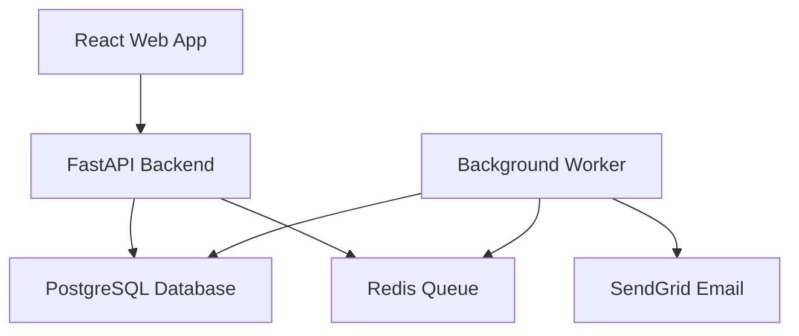
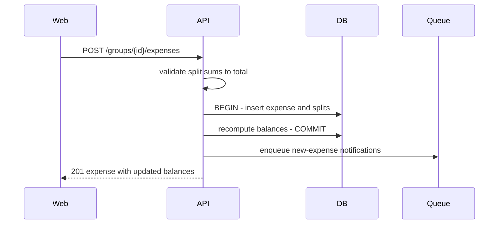
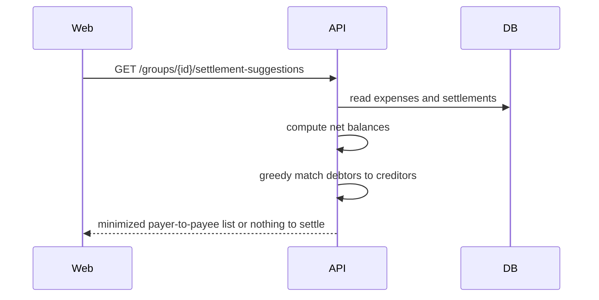
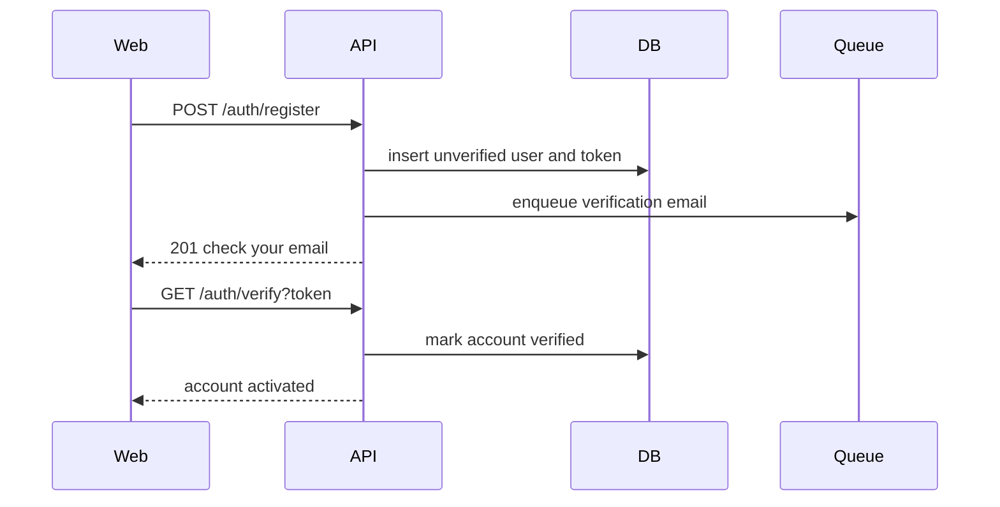
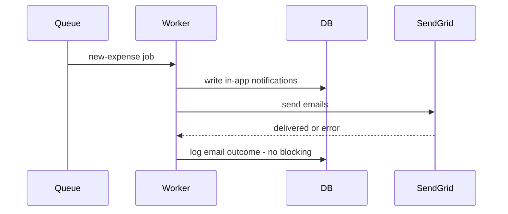
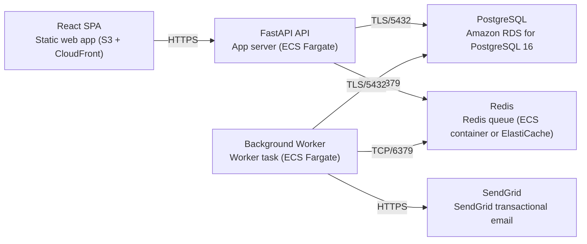

# Architecture

> Maintained by QuorQ AI SDLC. Text between `sdlc:auto` markers is regenerated; anything outside them is yours and is kept.

<!-- sdlc:auto:start narrative -->
## Overview

### ARCH-001 · approved · source: architecture:summary

Overall architecture approved at version 2: a responsive expense-splitting web app with a React 19 SPA, FastAPI 0.115 REST API, PostgreSQL 16, a Redis-backed background worker, and SendGrid for email, all hosted on AWS.

System overview (approved, v2): the backend owns all business rules -- email/password auth with verification, group membership and roles, expense logging with four split methods, atomic balance recalculation on every change, a debt-simplification algorithm for who-owes-whom, manual settlements, and in-app notifications. Emails never block core work: they are enqueued to Redis and sent asynchronously by a worker, which also runs scheduled payment reminders.

- ⚠ Input does not map individual requirement ids (US-001..US-017) to specific architecture elements, so most architecture entries below are traceable to the architecture spec itself but not to specific user stories -- recommend requirements-to-architecture mapping be confirmed by a human reviewer.

### COMP-web · approved · source: architecture:components:web

React 19 single-page frontend providing the entire end-user experience.

Responsive SPA handling registration, login, group management, expense entry with four split methods, a balance dashboard, settlement suggestions, and in-app notifications. Talks to the FastAPI backend over REST.

### COMP-api · approved · source: architecture:components:api

FastAPI 0.115 backend enforcing all business and authorization rules.

Enforces auth, group membership and ownership rules; logs expenses; recomputes balances atomically on every change; runs the debt-simplification algorithm; records settlements; and enqueues notification jobs to Redis for the worker to process.

### COMP-worker · approved · source: architecture:components:worker

Python background worker process consuming queued jobs for email and scheduled reminders.

Runs as a FastAPI 0.115-based Python worker process. Consumes queued jobs from Redis to send new-expense notification emails and runs scheduled payment-reminder sweeps, writing in-app notifications and calling SendGrid for delivery.

### COMP-db · approved · source: architecture:components:db

PostgreSQL 16 database holding all persistent state with transactional consistency.

Stores users, groups, members, invitations, expenses, splits, settlements and notifications. Transactional consistency ensures balances never drift from the expense and settlement records behind them.

### COMP-queue · approved · source: architecture:components:queue

Redis 7 message broker and scheduler backing asynchronous email and reminders.

Runs as redis:7-alpine. Acts as the message broker and scheduler for background email sending and timed reminders, letting the API hand off work without blocking the requesting user.

### COMP-email · approved · source: architecture:components:email

SendGrid SaaS service for all transactional email delivery.

Delivers verification links, group invites, and payment/new-expense notification emails on behalf of the worker.

### CP-expense-balance · approved · source: architecture:critical_paths:log_expense_and_recompute_balances

Core flow for logging an expense and keeping balances consistent.

A member adds an expense with a payer, involved members, and a split method. The backend validates that the split amounts sum to the total, persists the expense and its splits, recomputes all affected balances within a single transaction, and then enqueues notification jobs for the worker.

- ⚠ No requirement id in the known list is explicitly linked to this path in the input.

### CP-settlement-simplification · approved · source: architecture:critical_paths:simplified_settlement

Debt-simplification algorithm minimizing who-owes-whom transfers.

Given current net balances in a group, the backend runs a greedy debt-simplification algorithm that repeatedly matches the largest debtor to the largest creditor, minimizing the total number of transfers needed to settle the group.

- ⚠ No requirement id in the known list is explicitly linked to this path in the input.

### CP-registration-verification · approved · source: architecture:critical_paths:registration_and_email_verification

Account registration gated by mandatory email verification.

A user registers with email and password; the account is stored as unverified, a verification token is created, and a verification email is enqueued. Login is blocked until the verification link is opened.

- ⚠ No requirement id in the known list is explicitly linked to this path in the input.

### CP-background-notifications · approved · source: architecture:critical_paths:background_notifications_and_scheduled_reminders

Asynchronous notification and scheduled reminder processing.

The worker consumes queued new-expense jobs and runs scheduled debt-reminder sweeps, writing in-app notifications and sending email via SendGrid. Email failures are logged and never block the action that originated them.

**Related:** CP-expense-balance

- ⚠ No requirement id in the known list is explicitly linked to this path in the input.

### DATA-MODEL-001 · approved · source: architecture:entities

Relational data model spanning users, groups, expenses, splits, settlements and notifications.

Entities (approved v2): users(id, email, password_hash, is_verified, created_at); email_verifications(id, user_id, token, expires_at, used_at); groups(id, name, default_currency, creator_id, created_at); group_members(id, group_id, user_id, role, joined_at); invitations(id, group_id, email, token, status, created_by, expires_at, created_at); expenses(id, group_id, description, amount, expense_date, payer_id, created_by, split_method, created_at); expense_splits(id, expense_id, user_id, share_amount); settlements(id, group_id, payer_id, payee_id, amount, created_by, paid_at); notifications(id, user_id, group_id, type, message, is_read, created_at).

### API-ENDPOINTS-001 · approved · source: architecture:endpoints

20 REST endpoints covering auth, groups, expenses, balances, settlements and notifications.

Auth: POST /auth/register (register unverified + enqueue verification email), GET /auth/verify (verify via token, activate account), POST /auth/resend-verification, POST /auth/login (blocks unverified accounts, issues session token), POST /auth/logout. Groups: POST /groups (create, caller becomes admin), GET /groups (list caller's groups), PATCH /groups/{id} (edit name/currency, admin), POST /groups/{id}/invitations (invite by email or link, admin), POST /invitations/{token}/accept (join, rejects revoked/invalid), GET /groups/{id}/members (members only), DELETE /groups/{id}/members/{user_id} (admin only). Expenses: POST /groups/{id}/expenses (log + recompute balances + enqueue notifications), GET /groups/{id}/expenses (members only), PATCH /expenses/{id} (own or admin, recomputes balances), DELETE /expenses/{id} (own or admin, recomputes balances). Balances & settlements: GET /groups/{id}/balances (per-member net balances), GET /groups/{id}/settlement-suggestions (minimized transfers), POST /groups/{id}/settlements (record manual repayment, reduces balances). Notifications: GET /notifications (caller's in-app notifications), POST /notifications/{id}/read (mark read).

**Related:** CP-registration-verification, CP-expense-balance, CP-settlement-simplification, CP-background-notifications

### DEPLOY-001 · approved · source: architecture:deployment_nodes

All-AWS deployment topology for the approved architecture.

React SPA served as a static web app via S3 + CloudFront (React 19 build). FastAPI API runs as an app server on ECS Fargate (FastAPI 0.115 on Python 3.12). Background Worker runs as a Python worker task on ECS Fargate (Celery). PostgreSQL runs on Amazon RDS for PostgreSQL 16. Redis runs as a queue on an ECS container or ElastiCache (redis:7-alpine). SendGrid is used as the SaaS transactional email provider.

**Related:** COMP-web, COMP-api, COMP-worker, COMP-db, COMP-queue, COMP-email

### TECH-frontend · approved · source: architecture:technology_decisions:frontend

React 19 selected for the frontend over Vue and Svelte.

NFR-009: responsive single codebase requirement. React 19 drives the form-heavy expense builder with four split methods and a live-updating balance dashboard, rendering responsively on both phone and desktop from one codebase. Alternatives considered: Vue, Svelte.

**Related:** NFR-009

### TECH-backend · approved · source: architecture:technology_decisions:backend

FastAPI 0.115 selected for the backend over Django REST Framework and Flask.

FastAPI hosts auth, membership/ownership rules, atomic balance recalculation and the debt-simplification algorithm as a clean, well-typed Python API that is easy to unit-test. Alternatives considered: Django REST Framework, Flask.

- ⚠ No specific requirement id cited in the input for this decision.

### TECH-database · approved · source: architecture:technology_decisions:database

PostgreSQL 16 selected for the database over MySQL and SQLite.

NFR-008: balance consistency requirement. Transactions keep balances exactly consistent with the expenses and settlements behind them, and PostgreSQL's relational model fits groups, members, splits and settlements naturally. Alternatives considered: MySQL, SQLite.

**Related:** NFR-008

### TECH-cloud · approved · source: architecture:technology_decisions:cloud

AWS selected as the cloud provider over Google Cloud and Azure.

AWS runs the API and worker on Fargate, managed PostgreSQL on RDS, and Redis alongside, with encryption in transit and at rest for financial and credential data. Alternatives considered: Google Cloud, Azure.

- ⚠ No specific requirement id cited in the input for this decision.
<!-- sdlc:auto:end narrative -->

<!-- sdlc:auto:start building-blocks -->
## Building Block View

| ID | Name | Technology | Responsibility | Depends on |
|---|---|---|---|---|
| web | React Web App | React 19 | Responsive SPA for registration, login, groups, expense entry with four split methods, balance dashboard, settlement suggestions and in-app notifications. | api |
| api | FastAPI Backend | FastAPI 0.115 | REST API enforcing auth, membership and ownership rules, logging expenses, recomputing balances atomically, running the debt-simplification algorithm, recording settlements, and enqueueing notification jobs. | db, queue |
| worker | Background Worker | FastAPI 0.115 (Python worker process) | Consumes queued jobs to send new-expense notification emails and runs scheduled payment reminders, writing in-app notifications and calling SendGrid. | db, queue, email |
| db | PostgreSQL Database | PostgreSQL 16 | Stores users, groups, members, invitations, expenses, splits, settlements and notifications with transactional consistency so balances never drift from the records behind them. | — |
| queue | Redis Queue | Redis 7 (redis:7-alpine) | Message broker and scheduler backing background email sending and timed reminders so the API hands off work without blocking the user. | — |
| email | SendGrid Email | SendGrid (SaaS) | Transactional email delivery for verification links, group invites and payment/new-expense notifications. | — |

<!-- sdlc:auto:end building-blocks -->

<!-- sdlc:auto:start runtime -->
## Runtime View

### Log expense and recompute balances

A member adds an expense with payer, involved members and a split method; the backend validates the split sums to the total, persists the expense and splits, recomputes affected balances in one transaction, then enqueues notification jobs.

- **Components:** web, api, db, queue
- **Modules:** expenses_router, split_calculator, balance_service, notification_enqueuer
- **Key functions:** create_expense(group_id, payer_id, amount, method, members, weights), compute_shares(method, amount, members), recalc_group_balances(group_id), enqueue_new_expense_notifications(expense_id)

### Simplified who-owes-whom settlement

Given current net balances in a group, the backend runs a greedy debt-simplification that matches the largest debtor to the largest creditor repeatedly, minimizing the number of transfers.

- **Components:** web, api, db
- **Modules:** balance_service, settlement_optimizer
- **Key functions:** get_net_balances(group_id), simplify_debts(net_balances)

### Registration and email verification

A user registers with email/password; the account is stored unverified, a verification token is created and a verification email is enqueued. Login is blocked until the token is opened.

- **Components:** web, api, db, queue, email
- **Modules:** auth_router, password_service, verification_service
- **Key functions:** register(email, password), hash_password(password), issue_verification_token(user_id), verify_email(token)

### Background notifications and scheduled reminders

The worker consumes queued new-expense jobs and runs scheduled debt-reminder sweeps, writing in-app notifications and sending email via SendGrid; email failures are logged and never block the originating action.

- **Components:** worker, db, queue, email
- **Modules:** worker_tasks, reminder_scheduler, sendgrid_client, notification_service
- **Key functions:** send_new_expense_emails(expense_id), sweep_outstanding_debts(), create_in_app_notification(user_id, type, message), send_email(to, template, data)

<!-- sdlc:auto:end runtime -->

<!-- sdlc:auto:start deployment-view -->
## Deployment View

| Name | Service | Runtime | Scaling | Environment |
|---|---|---|---|---|
| React SPA | Static web app (S3 + CloudFront) | React 19 build | CDN edge | dev |
| FastAPI API | App server (ECS Fargate) | FastAPI 0.115 on Python 3.12 | horizontal (add tasks) | dev |
| Background Worker | Worker task (ECS Fargate) | Python worker (Celery) | horizontal (add workers) | dev |
| PostgreSQL | Amazon RDS for PostgreSQL 16 | PostgreSQL 16 | vertical + read replica when needed | dev |
| Redis | Redis queue (ECS container or ElastiCache) | redis:7-alpine | single node (dev) | dev |
| SendGrid | SendGrid transactional email | SaaS | managed | dev |

| Source | Target | Protocol |
|---|---|---|
| React SPA | FastAPI API | HTTPS |
| FastAPI API | PostgreSQL | TLS/5432 |
| FastAPI API | Redis | TCP/6379 |
| Background Worker | Redis | TCP/6379 |
| Background Worker | PostgreSQL | TLS/5432 |
| Background Worker | SendGrid | HTTPS |

<!-- sdlc:auto:end deployment-view -->

<!-- sdlc:auto:start decisions -->
## Architecture Decisions

| Layer | Choice | ADR |
|---|---|---|
| Frontend | React 19 | [ADR-0001](adr/frontend.md) |
| Backend | FastAPI 0.115 | [ADR-0002](adr/backend.md) |
| Database | PostgreSQL 16 | [ADR-0003](adr/database.md) |
| Cloud | AWS | [ADR-0004](adr/cloud.md) |
<!-- sdlc:auto:end decisions -->

<!-- sdlc:auto:start links -->
## Related Documents

- [Data Model](data-model.md)
- [API Specification](api/openapi.yaml)
- [Architecture Decision Records](adr/README.md)
<!-- sdlc:auto:end links -->
