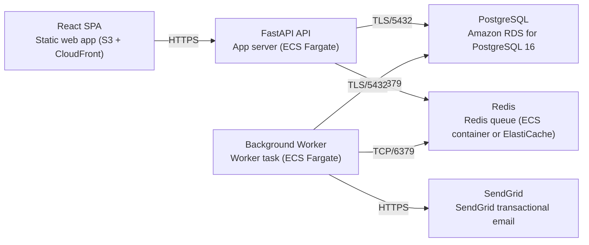

# Deployment Guide

> Maintained by QuorQ AI SDLC. Text between `sdlc:auto` markers is regenerated; anything outside them is yours and is kept.

<!-- sdlc:auto:start how-it-deploys -->
Pushes to `main` run `.github/workflows/deploy.yml`, which builds the API image (if there is a backend) and deploys the SPA to AWS Amplify. Commits touching only `docs/sdlc/**` don't deploy. Deployments can also be started from the platform's Deployment tab.
<!-- sdlc:auto:end how-it-deploys -->

<!-- sdlc:auto:start environments -->
| Name | Service | Runtime | Scaling | Environment |
|---|---|---|---|---|
| React SPA | Static web app (S3 + CloudFront) | React 19 build | CDN edge | dev |
| FastAPI API | App server (ECS Fargate) | FastAPI 0.115 on Python 3.12 | horizontal (add tasks) | dev |
| Background Worker | Worker task (ECS Fargate) | Python worker (Celery) | horizontal (add workers) | dev |
| PostgreSQL | Amazon RDS for PostgreSQL 16 | PostgreSQL 16 | vertical + read replica when needed | dev |
| Redis | Redis queue (ECS container or ElastiCache) | redis:7-alpine | single node (dev) | dev |
| SendGrid | SendGrid transactional email | SaaS | managed | dev |
<!-- sdlc:auto:end environments -->

<!-- sdlc:auto:start live -->
_Not deployed yet._
<!-- sdlc:auto:end live -->

<!-- sdlc:auto:start topology -->

<!-- sdlc:auto:end topology -->
